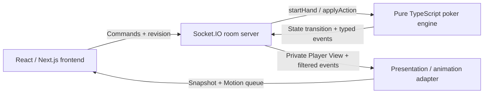

# PokerEZ

A browser-based poker platform for private, real-time Texas Hold'em games.

Create a room, invite friends with a room code, and play No-Limit Hold'em with **2–6 players**. No download or registration is required. All games use virtual chips.

**Live demo:** not deployed yet.


[How to play](#how-to-play) · [Architecture](#architecture) · [Local development](#local-development) · [Future development](#future-development)

## Features

- Private rooms with configurable fixed blinds, stable seats and online presence.
- Complete Hold'em hands: legal betting, all-ins, automatic runouts, side pots, split pots and per-pot payouts.
- Custom bet sizing with MIN and ALL IN, a turn timer, best-hand highlights and an in-table rules reference.
- Guest sessions that restore the same seat and private cards after a refresh or reconnect.
- Responsive tables, light/dark themes and event-driven card/chip animations with Reduced Motion support.
- A standalone, deterministic TypeScript engine with action-history replay, tests and a CLI simulator.

Learn includes rules and hand rankings. Profile is explicitly labeled sample data; it does not track live player statistics. The separate `/preview` route is a scripted animation playground.

## How to play

1. Select **Create Room**, choose the blinds and seat count, then share the six-character room code.
2. Friends enter the code under **Join Room**. The waiting room shows who is online and ready.
3. With at least two connected players holding chips, any player can select **Deal me in**.
4. Fold, check/call, or enter a bet. **Raise to** means the total committed on the current street. Legal ranges come from the server.
5. Review the per-pot result, then deal the next hand. A player without chips can top up between hands.

Refresh keeps your seat. Returning to the lobby also keeps it; **Leave room** releases it between hands. For two local players, use different browsers or profiles—ordinary tabs in one profile share a Guest identity.

## Architecture



- **Frontend:** room controls, table presentation and user input. It renders legal actions supplied by the engine rather than duplicating betting rules.
- **Multiplayer server:** authenticates Guests, owns in-memory rooms, orders commands and sends each recipient an authorized projection.
- **Engine:** independent state transitions, betting, best-five evaluation and pot settlement. It has no React, Socket.IO or runtime dependencies.
- **Animation adapter:** maps player views into seats/cards/pots and plays filtered events through DOM-anchored Motion components. Reconnects replace the presentation with a fresh snapshot.

## Engineering highlights

**Server-authoritative state.** Clients submit intent, not modified game state. The server supplies the authenticated Player ID. Hand IDs, revisions and request receipts reject stale actions and deduplicate retries.

**Secure dealing and private views.** Live hands use Fisher–Yates shuffling with Node's cryptographic `randomInt`. Complete state, deck and burn cards remain server-side. Player views and public/private event filters determine what each socket may receive.

**Session continuity.** Opaque HttpOnly Guest cookies identify players independently of socket connections. Refreshing restores the existing seat. A 45-second timer checks when legal and otherwise folds; reconnecting does not reset it.

**Betting and settlement in one place.** The engine handles short all-ins and per-player raise reopening. Contribution levels form independently eligible main/side pots, with uncalled refunds, split payouts and deterministic odd-chip allocation. The UI displays those results.

**Replayable rules, replaceable transport.** Seeded fixtures, recorded actions and typed events support reproducible engine tests and offline simulation. The same boundary can support future bot policies without coupling rules to the browser or network.

Implementation details: [Engine](packages/poker-engine/README.md), [Multiplayer protocol and operations](packages/multiplayer/README.md), [House rules](packages/poker-engine/house-rules.md).

## Tech stack

| Layer             | Technologies                                                               |
| ----------------- | -------------------------------------------------------------------------- |
| Interface         | Next.js, React, TypeScript, Tailwind CSS, Radix/shadcn-style UI primitives |
| State and themes  | Zustand, next-themes                                                       |
| Animation         | Motion for React, DOM anchors                                              |
| Multiplayer       | Node.js 24, Socket.IO, in-memory room storage                              |
| Rules and testing | Pure TypeScript, Vitest, fast-check, Node test runner                      |

## Local development

Requires **Node.js 24** and npm. From the repository root:

```sh
npm ci
npm run dev
```

Open [localhost:3000](http://localhost:3000). This starts Next.js on port **3000** and the multiplayer server on **3001**. The frontend proxies API and Socket.IO requests to the backend; local defaults need no environment variables or external services.

```sh
npm run check             # All tests, typechecks and builds
npm run engine:test      # Engine rules and randomized invariants
npm run server:test      # Real HTTP / Socket.IO integration tests
npm run adapter:test     # Player View and presentation mapping
npm test                 # Mock animation state tests
npm run engine:simulate  # Standalone CLI hand simulations
```

For a production build, run `npm run build`, then `npm start` to build the server and start both processes. Hosting needs HTTPS, allowed origins and a reverse proxy to the Node process; a static-only export cannot host multiplayer. See [server configuration](packages/multiplayer/README.md#configuration). Automatic GitHub Actions CI is disabled; use `npm run check` locally before pushing.

## Current limits

Rooms, Guest sessions and request receipts live in one process and are lost on backend restart. There is no database or registered account system. Joining, leaving and topping up happen between hands; disconnected seats remain reserved until explicitly released or the offline room expires. This is a fixed-blind, virtual-chip cash-table ruleset without tournaments or rake.

## Future development

The engine and multiplayer boundaries are intended to support a broader poker platform. The following work is **not implemented**:

- **Persistent hand history:** store hands, positions, decisions and outcomes for review and analysis beyond a server session.
- **Player analytics:** derive VPIP, PFR, aggression, position-specific results and recurring decision patterns from recorded hands, then explore useful strategy feedback.
- **AI poker bots and training:** first add reproducible offline policy evaluation and distinct play styles such as Tight-Aggressive, Loose-Passive and Calling Station. Later experiments could compare supervised learning, behavior cloning, self-play and reinforcement learning against those baselines.
