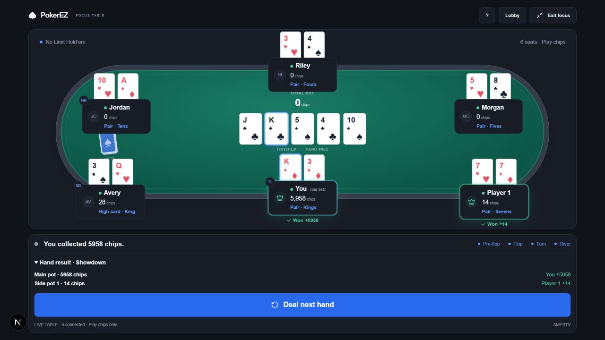
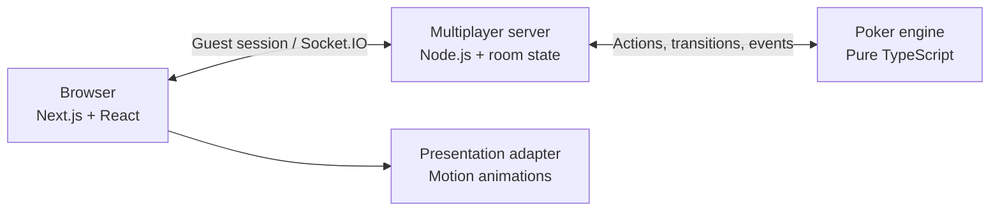

# PokerEZ

**No-Limit Texas Hold'em with friends, right in your browser.**

PokerEZ is a real-time poker app for private games with **2–6 players**. Create a table, share a six-character room code, and play full hands together. No downloads, accounts, or real-money stakes—just play chips.

**[Play PokerEZ](https://pokerez.onrender.com)** · [How to play](#how-to-play) · [Architecture](#how-it-works) · [What's next](#whats-next)



> **Live demo:** Hosted on Render's free tier. The first visit after inactivity may take a minute to wake the server. Games and guest sessions are currently stored in memory, so a server restart clears active tables.

## What you can do

- **Play with friends in real time.** Create a private room, choose the blinds and table size, invite friends by code, and see who's connected.
- **Play complete No-Limit Hold'em hands.** Fold, check, call, bet, raise, or go all-in. The engine handles betting order, minimum raises, short all-ins, side pots, split pots, and showdown payouts.
- **Follow the action.** Animated dealing, community cards, chip movements, turn indicators, countdowns, and per-pot results make each hand easy to read.
- **Keep your seat when you navigate away.** Guest sessions support refresh and reconnects, with a **Resume Game** shortcut when you're still seated. A timed-out action automatically checks if legal, otherwise folds.
- **Learn while you play.** Hand rankings, betting explanations, and an in-table reference help newer players understand what's happening.

The **Profile** page currently previews sample statistics; it does not yet save your real hands or results. The separate `/preview` route is an animation playground, not a live game.

## How to play

1. Open **[PokerEZ](https://pokerez.onrender.com)** and select **Create Room**. Set the number of seats and blinds.
2. Share the six-character room code. Friends can use **Join Room** from their own browsers or devices.
3. Once at least two players are connected, select **Deal me in**. Take turns using the actions shown for your seat.
4. After the hand, review the pot payouts and deal again. If you run out of play chips, you can top up between hands.

Use **Resume Game** to return to your current table after visiting other pages. A guest identity is stored in a browser cookie: two players testing on one computer should use different browser profiles or a normal and private window.

## How it works

PokerEZ separates the rules of poker from the network and the interface. The server is authoritative: browsers request actions, but they never decide which moves are legal, who wins, or how chips are distributed.



### Engineering decisions

**A rules engine independent of the UI.** The standalone TypeScript engine handles turn order, legal actions, hand evaluation, betting transitions, and side-pot settlement. It can be exercised from tests and a CLI simulator without React or Socket.IO.

**Server-authoritative multiplayer.** Socket.IO carries player commands and per-recipient updates. The server associates each action with an authenticated guest session, checks the hand ID and state revision, and deduplicates repeated requests so a retry cannot apply an action twice.

**Private game state.** Live hands are shuffled on the server using cryptographically secure randomness. Each player receives an authorized view and filtered events rather than the complete deck or another player's hidden cards.

**Event-driven presentation.** The game engine emits typed events; an adapter turns them into card, chip, board, and payout animations. On reconnect, the UI restores the latest server snapshot instead of trying to replay missed animations.

**Reproducible testing.** Fixed-seed engine fixtures, recorded actions, replay checks, randomized invariants, and real Socket.IO integration tests cover betting, chip conservation, hidden information, reconnects, and multi-pot settlement.

For implementation details, see the [engine documentation](packages/poker-engine/README.md), [multiplayer server documentation](packages/multiplayer/README.md), and [house rules](packages/poker-engine/house-rules.md).

## Tech stack

| Layer | Technologies |
| --- | --- |
| Web app | Next.js, React, TypeScript, Tailwind CSS |
| Real-time server | Node.js, Socket.IO |
| Poker rules | Standalone TypeScript state machine |
| UI state & animation | Zustand, Motion for React |
| Testing | Vitest, fast-check, Node.js test runner |
| Hosting | Render (single web service) |

## Run locally

Requires **Node.js 24** and npm.

```bash
git clone https://github.com/AlexMeng0831/PokerEZ.git
cd PokerEZ
npm ci
npm run dev
```

Open **http://localhost:3000**. This starts Next.js on port 3000 and the multiplayer server on port 3001. The web app proxies session and Socket.IO traffic to the server.

```bash
npm run check            # Tests, typechecks, and builds
npm run engine:test      # Poker rules and randomized invariants
npm run server:test      # Socket.IO integration tests
npm run adapter:test     # UI presentation tests
npm run engine:simulate  # Run example hands without the browser
```

## What's next

PokerEZ started as a way to play poker with friends. The longer-term goal is to use the same game engine as a foundation for **recording decisions, understanding playing styles, and experimenting with poker agents**. The playable table comes first; the features below are planned, not implemented.

### 1. Persistent hand history

Store hands beyond an individual server session: positions, effective stacks, public board cards, betting actions, pot sizes, and results. A player should be able to revisit a hand street by street instead of relying on the final win or loss. Persistent storage and user accounts would also make personal history available across devices. Hidden cards would remain subject to appropriate visibility rules.

### 2. Player profiles and decision analysis

Turn recorded hands into useful statistics such as **VPIP, PFR, aggression frequency, showdown tendencies, and results by position**. More interestingly, compare behavior across heads-up and multiway pots, stack depths, and betting streets.

The aim is to identify patterns—for example, entering too many pots passively, repeatedly chasing draws without sufficient pot odds, or bluffing in unfavorable situations. A lost hand is not automatically a bad decision, so any future feedback should distinguish decision quality from short-term outcomes and account for sample size.

### 3. Poker bots and a training environment

Start with interpretable baseline bots—**Tight-Aggressive, Loose-Passive, Calling Station**, and more—and evaluate their performance in repeatable offline matches. Because the engine runs independently of the website, simulated hands do not need a browser or WebSocket connection.

That provides a path toward supervised behavior cloning from appropriately labeled decisions, comparing learned policies against rule-based baselines, and eventually self-play or reinforcement learning. The goal is to make experimenting with strategies measurable and reproducible, not simply to attach an AI label to the game.

### 4. Insights back in the product

Eventually, connect the two sides: let players review their own histories, understand their tendencies, and practice against bots with distinct styles. The game would remain simple to join and play while offering deeper tools to anyone interested in improving.

## Current limitations

PokerEZ currently uses **play chips only**, with guest sessions and in-memory rooms. There are no permanent accounts, saved player statistics, or persistent games. Server restarts clear active tables; the public demo may also take time to wake after inactivity. The ruleset is a fixed-blind cash-style table, not a tournament system.
